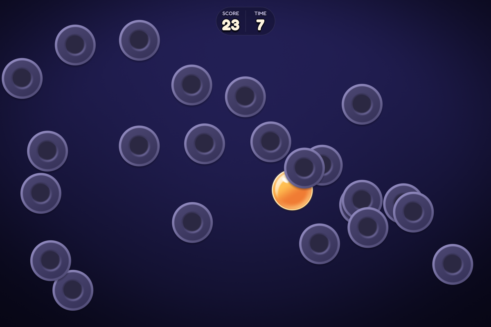

<!--
  SPDX-FileCopyrightText: 2026 setdef
  SPDX-License-Identifier: LicenseRef-setdef-all-rights-reserved
-->
# Dot Popper

[](https://github.com/setdef/dot_popper/releases) [](#install)

**Pop the bright dot. Every dot you pop stays on the screen.**

Dot Popper is an arcade game for one player, on Mac, Windows, and Linux. One bright dot bounces around the screen. Click it, and it pops, and a new bright dot appears. The dots you have popped keep bouncing, and each new dot appears underneath them all.

A game starts with 10 seconds on the clock. Each dot you pop gives you a point and a second. A click on a popped dot takes away 2 points and 2 seconds. After 20 dots are popped, 20 dull dots crowd the screen, and the bright one can be under any of them. Wait for it to slide out, or take a chance.



*The bright dot, sliding out from under a popped one.*

[Download Dot Popper](#install) from the releases page.

## What's in the game

- **Free and Pro.** The game is Free to start. A Free copy has a first stock of games that never refills, and 3 games a day that don't carry over; each game you start spends the day's first, so the stock lasts. The title says how many games are left, and watching the tutorial or How to play costs none, but the game it goes on into does. There is no way to earn more: Pro, bought once, makes games unlimited and adds Achievements, Themes and Friend groups. Those look the same to everyone; a Free player who taps one is taken to the Pro page, opening with what they tapped, and Back returns to where they were. When no games are left, Play opens the same page. On a phone or tablet, and on a copy from a computer's store, it also has Restore Purchases for a purchase you already made. Other computers' copies have Paste license key instead, which enters a license key: on a copy from setdef's website, Buy finishes in your browser and the key comes by email. One key holds Pro on one device at a time. A computer's copy counts games only where Pro can be bought; a copy with no way to buy counts none.
- **A goal for each day.** Dot Popper sets one goal each day for a single game, the same for every player that day, such as "score 10 points in a game without a single mistake" or "pop a bright dot that has been on screen for at least 3 seconds." Meet it on days in a row, and the game counts your streak on Home.
- **Stats and records.** On the Stats screen, the game keeps your record score, your longest game, your most dots in a row without a mistake, your shortest and longest time to pop, and a chart of your last 20 games, with totals for every game you have played.
- **Themes.** Now and then a new theme arrives, such as ghosts or jack-o'-lanterns: its own dots, night and sounds. The game tells you once, with a preview and one tap to switch, and it stays yours from then on, offline too. Pro players can wear any theme from Themes. A theme never changes how the game plays, or where you can tap.
- **A pile to play with.** When time runs out, the dots tumble into a heap at the bottom of the screen. Grab one and throw it while you read your score.
- **A score to share.** Click Share my score, and the game shows the words it would share. Click Copy, and they go on the clipboard, ready to paste into a chat. Nothing is copied until you click Copy. On an iPhone, iPad or Android phone, Share my score opens the phone's own share sheet with the same words instead:

  ```text
  Dot Popper: 24 points
  🟡 26 dots · ⚫ 1 mistake · ⏱ 34 seconds
  Played with dots sized to the screen.
  ```

- **Mouse, keyboard, or controller.** Play with whichever is in your hand. The buttons follow what you last pressed: Play becomes "Play (A)" when you pick up a controller, and the tutorial shows each tap with your own pointer, finger, or controller.
- **Sound from where it happens.** Popping a dot on the left of the screen plays from your left speaker.

<p>
  
  
</p>

## Dot size

At the start of each game, Dot Popper sizes the dots to your screen, so that every screen is about as crowded as a 1200 × 800 window. That narrows the difference between screens, but not all of it: scores still differ between screen sizes and between ways of playing, such as a mouse, a finger or a controller.

On a screen where the size makes a visible difference, such as a large monitor in fullscreen, the game offers a Dot size choice in Settings. Standard dots are the same size on every screen: a large screen gives you more room, and a small window crowds sooner. Dot Popper keeps your records with standard dots apart for small, medium, and large screens, so a game on one never competes with a game on another.

## Install

Download the file for your computer from the [releases page](https://github.com/setdef/dot_popper/releases), and open it:

| Your computer | Download | Then |
| --- | --- | --- |
| A Mac with Apple silicon (M1 or newer), on macOS 14 or newer | `Dot.Popper-arm64-darwin.dmg` | Open it, and drag Dot Popper to Applications |
| Windows 10 or 11, on x64 | `Dot.Popper-x64-mingw-ucrt-setup.exe` | Run it. It installs Dot Popper without administrator rights |
| Linux on x86_64 with glibc 2.39 or newer, such as Ubuntu 24.04, Debian 13, or Fedora 40 | `Dot.Popper-x86_64-linux.AppImage` | Mark it executable (`chmod +x`), and run it |

If you'd rather not install anything, the `.zip` for Windows and the `.tar.gz` for Mac and Linux hold the same game, to unpack and run from any folder.

These downloads are not signed with a certificate from Apple or Microsoft, so your computer warns you the first time you open the game:

- **On a Mac,** macOS says it could not verify that Dot Popper is free of malware, and does not open it. Open System Settings, choose Privacy & Security, scroll down to the message about Dot Popper, and click Open Anyway.
- **On Windows,** SmartScreen says it protected your PC. Click More info, then Run anyway.

### Updating

Dot Popper does not update itself. Download the newest release and install it over the old one. Your stats stay, because the game saves them in your user folder, not inside the app.

## How to play

Press Play, and pop the bright dot, again and again, until the clock runs out.

The first time you press Play, a short tutorial with no words shows you how, in about 20 seconds: a dot popping, the point and second it gives, what a click on a popped dot costs and does to your dots in a row, and a bright dot to wait for. The clock waits meanwhile, a click on a popped dot does nothing, and when the tutorial ends, your first game goes on from it, with its dots, its points and its time, and the clock starts. Skip it with the ⏭ button in the corner, Escape, or B on a controller. It never opens by itself again, even after you clear your records, but How to play, at the bottom of Home once you have played a game, plays it whenever you like, and H or Y on a controller does too. Your game then goes on from it, as it does the first time.

| To | With a mouse and keyboard | With a controller |
| --- | --- | --- |
| Pop a dot | Click it | Aim with the left stick or the d-pad, and press A or the right trigger |
| Start a game, or the next after Game Over | Click Play or Play again, or press Enter or Space | A, or Start |
| Open Stats, Achievements or Themes, from Home | Click its button | X, LB or RB |
| Watch how to play again, from Home | Click How to play, or press H | Y |
| Open Settings, from Home | Click Settings | View (also called Back or Select) |
| Go back | Click Back, or press Escape | B |
| Scroll a list | The mouse wheel, the arrow and Page keys, or drag it | The right stick |
| Share your score, after a game | Click Share my score, then Copy. Escape closes it | Y, then Y or A to copy. B closes it |
| Throw a dot, after a game | Drag it and let go | Hold A on a dot, move, and let go. The right stick rolls the whole pile |
| Change the dot size | Choose it in Settings | LB, in Settings |
| Turn the sound off or on | Press M, or choose it in Settings | View, in Settings |
| Switch to fullscreen and back | Choose Window, Borderless or Full screen in Settings, or press F11, or Alt+Enter (Cmd+Enter on a Mac) | RB, in Settings |
| Quit | Click Quit on Home, or press Escape, on Home or during a game | B twice, on Home |

On a Mac, Windows or Linux, Quit sits beside Settings at the bottom of Home, and Settings holds the Display choice, so the mouse alone can fill the screen and leave the game, even in fullscreen, where the window's own buttons are gone. From any other screen, click Back, or Home on Game Over, to get Home.

## Good to know

- **Your stats stay on this computer.** Dot Popper saves them in a `dot_popper` folder: `~/Library/Application Support/dot_popper` on a Mac, `%APPDATA%\dot_popper` on Windows, and `~/.local/share/dot_popper` on Linux. It also writes one line for each game you finish to `games.csv` in that folder. Apart from the themes check below, a playtest release makes no network connections until you create or join a friend group. A copy built for sale, from setdef's website or a store, also asks setdef's server for its signed proof once each time it starts (`GET /proof`), and only if no valid proof comes, Apple's, Google's or Microsoft's connectivity check, to tell setdef being gone from the internet being down. A copy holding a license key also sends it to setdef's server when you enter it (`POST /licenses`) and checks it once each start (`POST /license_checks`), so the key holds Pro on one device at a time. Every request is listed in [doc/privacy.json](doc/privacy.json).
- **Friend groups, for those who join one.** Where a group server is offered, the title has a Friend groups button. You can be in up to 20 groups of up to 8 players; each group has one title, and any game that beats the group's top score wins it. The first time you create or join a group, which takes Pro, the game sends that server a request for an anonymous token and, from then on, the score of each counting game; the server also sees your IP address. You type no name and no text: the game draws each member an icon and gives each group and member a name of its own, and you join with a short code of digits you tap. The game asks you for no account or email. Leave takes you out of a group, and holding Delete my data removes your scores from the server; neither needs Pro. Until you create or join a group, the game sends nothing to that server. The themes check, `GET /themes?started_on=`, sends the date you first played and no token; like every request, it shows the server your IP address. The server's proxy and logs see IP addresses, and its rate-limit entries keep them for up to a day.
- **Starting over.** On the Stats screen, press and hold Clear my stats… for 2 seconds. For 10 seconds after, you can click Undo to bring them back.
- **Less motion.** Start the game with `DOT_POPPER_CALM=1` in its environment to turn off the screen shake and let the pile settle gently. On a Mac, run this in Terminal: `DOT_POPPER_CALM=1 "/Applications/Dot Popper.app/Contents/MacOS/Dot Popper"`. The game has no on-screen setting for it.
- **Graphics.** On Windows, Dot Popper draws with Vulkan where it can, so the Xbox Game Bar shows over it in fullscreen, and with OpenGL otherwise. If Vulkan can't start the game, as in a virtual machine or over Remote Desktop, the game starts again by itself with OpenGL. On Linux it draws with OpenGL, and on Android with OpenGL ES. If your graphics driver cannot run one of the game's shaders, the game leaves that shader out and draws with plain shapes instead.
- **Where it has been played.** People have played Dot Popper on a MacBook Air with an M4 and on a Windows PC. The Linux build has run only in automated tests, with software graphics. Versions for iPhone, iPad, and Android are in testing, and not available to download.

## Reporting problems

Open an [issue on GitHub](https://github.com/setdef/dot_popper/issues). Say which computer and system you play on, and the name of the file you downloaded.

## Credits and license

Dot Popper is made by setdef, © 2026 setdef, all rights reserved. Its lettering is set in Fredoka and Iosevka, under the SIL Open Font License, and its tutorial's pointing hand is Noto Emoji's, under the [Apache License 2.0](LICENSES/Apache-2.0.txt). To see every open-source license that comes with the game, open the Credits and licenses screen from Settings.

Versions up to and including v0.9.9 were published under the AGPL-3.0-or-later, and remain available on those terms at their tags. See [LICENSE](LICENSE).

To build Dot Popper yourself, change it, or read how it works, see the [developer guide](doc/README.md).
