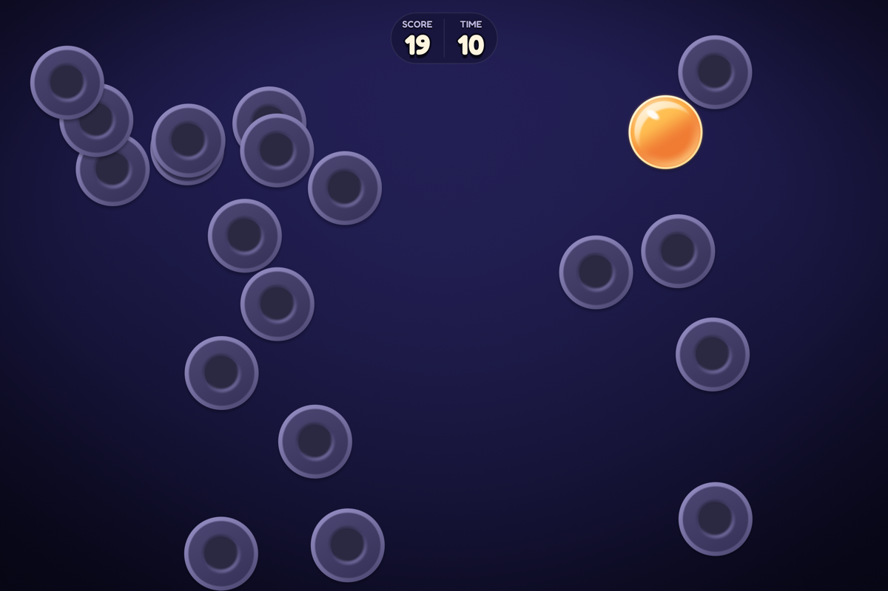
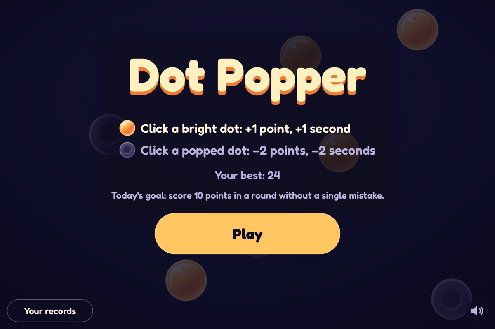
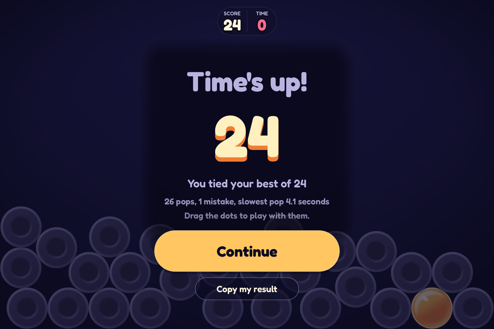

<!--
  SPDX-FileCopyrightText: 2026 setdef
  SPDX-License-Identifier: LicenseRef-setdef-all-rights-reserved
-->
# Dot Popper

[](https://github.com/setdef/dot_popper/releases) [](#install)

**Pop the bright dot. Every dot you pop stays on the screen.**

Dot Popper is an arcade game for one player, on Mac, Windows, and Linux. One bright dot bounces around the screen. Click it, and it pops, and a new bright dot appears. The dots you have popped keep bouncing, and each new dot appears underneath them all.

A round starts with 10 seconds on the clock. Each pop gives you a point and a second. A click on a popped dot takes away 2 points and 2 seconds. After 20 pops, 20 dull dots crowd the screen, and the bright one can be under any of them. Wait for it to slide out, or take a chance.



*The bright dot, sliding out from under a popped one.*

[Download Dot Popper](#install) from the releases page.

## What's in the game

- **A goal for each day.** Dot Popper sets one goal each day for a single round, the same for every player that day, such as "score 10 points in a round without a single mistake" or "pop a bright dot that has been on screen for at least 3 seconds." Meet it on days in a row, and the game counts your streak on the title screen.
- **Records.** On the Records screen, the game keeps your best score, your longest round, your most pops in a row without a mistake, your fastest pop, and a chart of your last 20 rounds, with totals for every round you have played.
- **Holiday looks (the paid version).** During Halloween, the winter holidays and Valentine's week, the game wears that season's colors. Play one round then and the look is yours for good, to choose again all year from Looks on the Records screen; one you miss comes back the next year. A look changes colors only: the bright dot stays light and glossy against the dark, popped ones, so no look makes the game harder to read. A free player still sees on the Looks screen which looks exist and which they have earned, kept for the day they buy the full version; achievements on the Records screen show the same way.
- **A pile to play with.** When time runs out, the dots tumble into a heap at the bottom of the screen. Grab one and throw it while you read your score.
- **A score to share.** Click Share my score, and the game shows the words it would share. Click Copy, and they go on the clipboard, ready to paste into a chat. Nothing is copied until you click Copy. On an iPhone, iPad or Android phone, Share my score opens the phone's own share sheet with the same words instead:

  ```text
  Dot Popper: 24 points
  🟡 26 pops · ⚫ 1 mistake · ⏱ 34 seconds
  Played with dots sized to the screen.
  ```

- **Mouse, keyboard, or controller.** Play with whichever is in your hand. The buttons follow what you last pressed: Play becomes "Play (A)" when you pick up a controller, and the tutorial shows each tap with your own pointer, finger, or controller.
- **Sound from where it happens.** A pop on the left of the screen plays from your left speaker.

<p>
  
  
</p>

## Dot size

At the start of each round, Dot Popper sizes the dots to your screen, so that every screen is about as crowded as a 1200 × 800 window. Your scores then compare with your friends' on other computers.

On a screen where the size makes a visible difference, such as a large monitor in fullscreen, the game offers a Dot size choice on the title screen. Standard dots are the same size on every screen: a large screen gives you more room, and a small window crowds sooner. Dot Popper keeps your bests with standard dots apart for small, medium, and large screens, so a round on one never competes with a round on another.

## Install

Download the file for your computer from the [releases page](https://github.com/setdef/dot_popper/releases), and open it:

| Your computer | Download | Then |
| --- | --- | --- |
| A Mac with Apple silicon (M1 or newer), on macOS 14 or newer | `Dot.Popper-arm64-darwin.dmg` | Open it, and drag Dot Popper to Applications |
| Windows 10 or 11, on x64 | `Dot.Popper-x64-mingw-ucrt-setup.exe` | Run it. It installs Dot Popper without administrator rights |
| Linux on x86_64 with glibc 2.39 or newer, such as Ubuntu 24.04, Debian 13, or Fedora 40 | `Dot.Popper-x86_64-linux.AppImage` | Mark it executable (`chmod +x`), and run it |

If you'd rather not install anything, the `.zip` for Windows and the `.tar.gz` for Mac and Linux hold the same game, to unpack and run from any folder.

These downloads are not signed with a certificate from Apple or Microsoft, so your computer warns you the first time you open the game:

- **On a Mac,** macOS says it could not verify that Dot Popper is free of malware, and does not open it. Open System Settings, choose Privacy & Security, scroll down to the message about Dot Popper, and click Open Anyway.
- **On Windows,** SmartScreen says it protected your PC. Click More info, then Run anyway.

### Updating

Dot Popper does not update itself. Download the newest release and install it over the old one. Your records stay, because the game saves them in your user folder, not inside the app.

## How to play

Press Play, and pop the bright dot, again and again, until the clock runs out.

The first time you press Play, a short tutorial with no words shows you how, in about 20 seconds: a pop, the point and second it gives, what a click on a popped dot costs, and a bright dot to wait for. The clock waits meanwhile, but a click on a popped dot costs what it does in a round, and when the tutorial ends, your first round goes on from it, with its dots, its points and its time, and the clock starts. Skip it with the ⏭ button in the corner, Escape, or B on a controller. It never opens by itself again, even after you clear your records, but How to play, in the title's bottom right corner, plays it whenever you like, and H or Y on a controller does too. Your round then goes on from it, as it does the first time.

| To | With a mouse and keyboard | With a controller |
| --- | --- | --- |
| Pop a dot | Click it | Aim with the left stick or the d-pad, and press A or the right trigger |
| Start a round, or continue after one | Click Play or Continue, or press Enter or Space | Start, or A on the button |
| Open your records, from the title | Click Your records | X |
| Watch how to play again, from the title | Click How to play, or press H | Y |
| Leave the Records screen | Click Back, or press Escape | B, or Start |
| Share your score, after a round | Click Share my score, then Copy. Escape closes it | Y, then Y or A to copy. B closes it |
| Throw a dot, after a round | Drag it and let go | Hold A on a dot, move, and let go. The right stick rolls the whole pile |
| Change the dot size, from the title | Click the Dot size choice | Either shoulder button |
| Turn the sound off or on | Press M, or click the speaker in the corner of the title | Back (also called View or Select) |
| Switch to fullscreen and back | Click Full screen (Window, in fullscreen) on the title, or press F11, or Alt+Enter (Cmd+Enter on a Mac) | Aim at Full screen on the title, and press A |
| Quit | Click Quit on the title, or press Escape, on the title or during a round | B twice, on the title |

On a Mac, Windows or Linux, Full screen and Quit sit between How to play and the speaker, in the title's bottom row, so the mouse alone can fill the screen and leave the game, even in fullscreen, where the window's own buttons are gone. From the Records screen or Game Over, click Back or Continue to get to the title. On a small window, they show only their icons, and on the smallest, in the title's top right corner.

## Good to know

- **Your records stay on this computer.** Dot Popper saves them in a `dot_popper` folder: `~/Library/Application Support/dot_popper` on a Mac, `%APPDATA%\dot_popper` on Windows, and `~/.local/share/dot_popper` on Linux. It also writes one line for each round you finish to `rounds.csv` in that folder. Dot Popper makes no network connections and collects nothing, unless you create or join a friend group.
- **Friend groups, for those who join one.** A version of the game with a group server offers a Group button on the title. The first time you create or join a group, the game sends the dot you pick (one of eight the game draws; you type no name and no text) to that server and, from then on, the score of each counting round. You join with a short code of digits you tap. The game asks you for no account or email. The Group screen's Leave group takes you out, and holding Delete my data removes your scores from the server. Without a group, the game never connects to anything.
- **Starting over.** On the Records screen, press and hold Clear my records… for 2 seconds. For 10 seconds after, you can click Undo to bring them back.
- **Less motion.** Start the game with `DOT_POPPER_CALM=1` in its environment to turn off the screen shake and let the pile settle gently. On a Mac, run this in Terminal: `DOT_POPPER_CALM=1 "/Applications/Dot Popper.app/Contents/MacOS/Dot Popper"`. The game has no on-screen setting for it.
- **Graphics.** On Windows, Dot Popper draws with Vulkan where it can, so the Xbox Game Bar shows over it in fullscreen, and with OpenGL otherwise. If Vulkan can't start the game, as in a virtual machine or over Remote Desktop, the game starts again by itself with OpenGL. On Linux it draws with OpenGL, and on Android with OpenGL ES. If your graphics driver cannot run one of the game's shaders, the game leaves that shader out and draws with plain shapes instead.
- **Where it has been played.** People have played Dot Popper on a MacBook Air with an M4 and on a Windows PC. The Linux build has run only in automated tests, with software graphics. Versions for iPhone, iPad, and Android are in testing, and not available to download.

## Reporting problems

Open an [issue on GitHub](https://github.com/setdef/dot_popper/issues). Say which computer and system you play on, and the name of the file you downloaded.

## Credits and license

Dot Popper is made by setdef, © 2026 setdef, all rights reserved. Its lettering is set in Fredoka and Iosevka, under the SIL Open Font License, and its tutorial's pointing hand is Noto Emoji's, under the [Apache License 2.0](LICENSES/Apache-2.0.txt). To see every open-source license that comes with the game, open the Credits screen from the Records screen.

Versions up to and including v0.9.9 were published under the AGPL-3.0-or-later, and remain available on those terms at their tags. See [LICENSE](LICENSE).

To build Dot Popper yourself, change it, or read how it works, see the [developer guide](doc/README.md).
